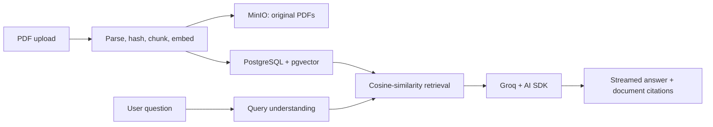

# UoMBot

**A university assistant that answers questions using institutional PDFs and source citations.**


Built by [Socrates Omiliadis](https://github.com/socratesomiliadis) for a bachelor's thesis in Applied Informatics at the **University of Macedonia**, Thessaloniki, Greece.

UoMBot brings university documents into a searchable knowledge base. Students can ask questions in Greek or English, receive streamed answers, and inspect the documents retrieved to support them. The system uses retrieval-augmented generation (RAG): it searches the uploaded corpus before generating an answer.

## What it does

- **Document ingestion:** upload text-based PDFs, extract and clean their text, split it into overlapping chunks, and store embeddings.
- **Broader retrieval:** a query-understanding tool can generate up to two alternative phrasings; retrieval combines and deduplicates results from the original and additional questions.
- **Source visibility:** streamed responses include retrieved-document citations and metadata.
- **Persistent conversations:** signed-in users can return to their saved chats.
- **Resource management:** admin pages list uploaded resources, processing status, and document statistics.
- **Request limits:** chat and PDF uploads use an in-memory rate limiter.

The knowledge base starts empty. Answers depend on the documents you upload; a citation makes an answer inspectable but does not guarantee its correctness.

## Stack

| Area | Implementation |
| --- | --- |
| Application | Next.js 16, React 19, TypeScript, Tailwind CSS 4 |
| Chat | Vercel AI SDK 5 and Groq; the chat route currently selects `moonshotai/kimi-k2-instruct-0905` |
| Embeddings | Google `gemini-embedding-001`, with 1,536 output dimensions |
| Database | PostgreSQL 17, pgvector, and Drizzle ORM |
| Documents | `pdf-parse` and MinIO/S3-compatible storage |
| Authentication | Better Auth with email/password sessions and user/admin roles |
| UI | Radix UI components, Lucide icons, and Motion |

## How the system works



The [PDF pipeline](web/lib/pipeline/pdf-pipeline.ts) hashes cleaned text to detect previously indexed content. Its [chunker](web/lib/ai/chunking.ts) targets approximately 400 estimated tokens with 50-token overlap; token counts are heuristic rather than model-tokenizer measurements.

[Retrieval](web/lib/ai/embedding.ts) filters chunks by cosine similarity and returns up to `MAX_SOURCES` results **per query**. The [chat route](web/app/api/chat/route.ts) merges results from additional phrasings, deduplicates chunks by resource and chunk index, and emits one source entry per document. HNSW indexes are defined in the database schema; no retrieval-latency benchmark is reported here.

## Run locally

Use the Next.js app on your host and Docker for PostgreSQL and MinIO.

### 1. Prerequisites and configuration

- Node.js **20.9 or newer**, matching [Next.js 16's minimum requirement](https://nextjs.org/docs/app/getting-started/installation#system-requirements).
- pnpm compatible with the committed v9 lockfile.
- Docker with Compose.
- Google AI and Groq API keys with access to the models above.

```bash
git clone https://github.com/socratesomiliadis/uombot.git
cd uombot
cp .env.example .env
```

Edit the root `.env`: fill in `GOOGLE_GENERATIVE_AI_API_KEY`, `GROQ_API_KEY`, and `BETTER_AUTH_SECRET`. Generate the authentication secret with:

```bash
node -e "console.log(require('node:crypto').randomBytes(32).toString('hex'))"
```

The template supplies local database/storage credentials. Keep PostgreSQL's credentials consistent with `DATABASE_URL`, and MinIO's credentials consistent with `S3_ACCESS_KEY`/`S3_SECRET_KEY`.

Copy the completed configuration into the web application as well:

```bash
cp .env web/.env
```

Compose reads the root `.env`; the application and migration command run from `web/` and read `web/.env`. Keep those copies in sync when changing local settings.

### 2. Start infrastructure and prepare storage

```bash
docker compose up -d db minio
docker compose ps
```

Wait for both services to be healthy. Open the [MinIO console](http://localhost:9001), sign in using `MINIO_ROOT_USER` and `MINIO_ROOT_PASSWORD`, and create the bucket named by `S3_BUCKET` (the template uses `uombot-documents`). The application expects this bucket to exist.

### 3. Install, migrate, and start the app

```bash
cd web
pnpm install --frozen-lockfile
pnpm db:migrate
pnpm dev
```

Open [localhost:3000](http://localhost:3000). Migrations create the tables and enable the vector extension.

| Service | Local address |
| --- | --- |
| Web app | `http://localhost:3000` |
| MinIO console | `http://localhost:9001` |
| MinIO S3 API | `http://localhost:9000` |
| PostgreSQL | `localhost:5432` |

### 4. Add documents and try a conversation

Create an account at `/sign-up`. New accounts have the `user` role. To use the admin interface in your **local development database**, run this from the repository root, replacing the sample email with your new account:

```bash
docker compose exec db psql -U postgres -d uombot -c "UPDATE users SET role = 'admin' WHERE email = 'you@example.com';"
```

Sign out and back in, then visit `/admin/upload`. Upload a text-based university PDF, supply its title/language, and check its status under `/admin/resources`. The upload limit is 10 MiB and processing runs within the upload request.

Open `/chat` and ask a question covered by that document. For example, if you uploaded a study guide, try “What are the graduation requirements?” or “Ποιες είναι οι προϋποθέσεις αποφοίτησης;”. These are example prompts, not evaluated test cases. Inspect the cited sources alongside the answer.

## Configuration reference

Defaults and validation are defined in [`web/lib/env.ts`](web/lib/env.ts).

| Variables | Purpose |
| --- | --- |
| `POSTGRES_USER`, `POSTGRES_PASSWORD`, `POSTGRES_DB` | Compose database initialization; template user/database match the existing health check |
| `DATABASE_URL` | App and migration database connection; use `localhost` for the host-run app |
| `MINIO_ROOT_USER`, `MINIO_ROOT_PASSWORD` | Compose MinIO credentials |
| `S3_ENDPOINT`, `S3_ACCESS_KEY`, `S3_SECRET_KEY`, `S3_BUCKET` | App storage connection and existing bucket |
| `BETTER_AUTH_URL`, `NEXT_PUBLIC_BETTER_AUTH_URL`, `BETTER_AUTH_SECRET` | Auth origins and secret |
| `GOOGLE_GENERATIVE_AI_API_KEY`, `GROQ_API_KEY` | Embedding and chat providers; both are required by environment validation |
| `SIMILARITY_THRESHOLD` | Minimum cosine similarity, default `0.6` |
| `MAX_SOURCES` | Maximum results per retrieval query, default `3`, allowed range `1–10` |

### Containerized web app

The repository also includes a [web Dockerfile](web/Dockerfile) and a `web` Compose service. The local path above avoids two configuration differences that must be resolved before using that service:

- The container needs a `DATABASE_URL` pointing to `db:5432`, rather than `localhost:5432`.
- Compose passes `GROQ_API_KEY` as a **build argument**, but its web **runtime environment** currently lists `OPENROUTER_API_KEY` instead. Add `GROQ_API_KEY` to the runtime environment; the current app uses Groq, not OpenRouter.

Database migrations and bucket creation also remain explicit setup steps. A plain `docker compose up` is therefore not documented as a complete application bootstrap.

## Checks and useful commands

Run from `web/`:

```bash
pnpm lint
pnpm exec tsc --noEmit
pnpm build
```

Other available scripts are `pnpm db:generate`, `pnpm db:migrate`, `pnpm db:push`, and `pnpm db:studio`; see [`package.json`](web/package.json). Use committed migrations for the setup above.

From the repository root, `docker compose logs db minio` shows infrastructure logs and `docker compose stop db minio` stops those services.

## Evaluation and current limits

The public repository does not include a labeled evaluation dataset, a retrieval benchmark runner, or an automated test suite. This README consequently makes no numerical claims about retrieval quality or response latency.

A reproducible evaluation should publish its corpus snapshot, labeled questions and relevant document/chunk IDs, a single-query baseline, fixed model/settings, and a report covering Recall@k, citation quality, and latency. Greek and English cases should be reported separately.

Current implementation limits:

- PDF extraction handles embedded text; an OCR stage for scanned documents is not implemented.
- The rate limiter stores counters in process memory. Chat allows 30 requests/minute and uploads 10/hour per user; counters are not shared across instances.
- Password-reset and verification callbacks log links instead of sending mail.
- Uploaded documents form a shared knowledge base; per-user document isolation is not implemented.
- `/api/health` checks database connectivity, not storage or AI-provider readiness.

## Explore the code

| Path | What to inspect |
| --- | --- |
| [`web/app/api/chat/route.ts`](web/app/api/chat/route.ts) | Query tools, streaming, citations, and conversation persistence |
| [`web/lib/ai/embedding.ts`](web/lib/ai/embedding.ts) | Embedding generation and cosine-similarity retrieval |
| [`web/lib/pipeline/pdf-pipeline.ts`](web/lib/pipeline/pdf-pipeline.ts) | PDF ingestion, hashing, chunk storage, and embedding batches |
| [`web/lib/db/schema/`](web/lib/db/schema/) | Auth, chat, resources, and vector data models |
| [`web/lib/auth/index.ts`](web/lib/auth/index.ts) | Session authentication and role fields |
| [`web/lib/storage/s3.ts`](web/lib/storage/s3.ts) | MinIO/S3 file storage |
| [`web/proxy.ts`](web/proxy.ts) | Session and admin page access |
